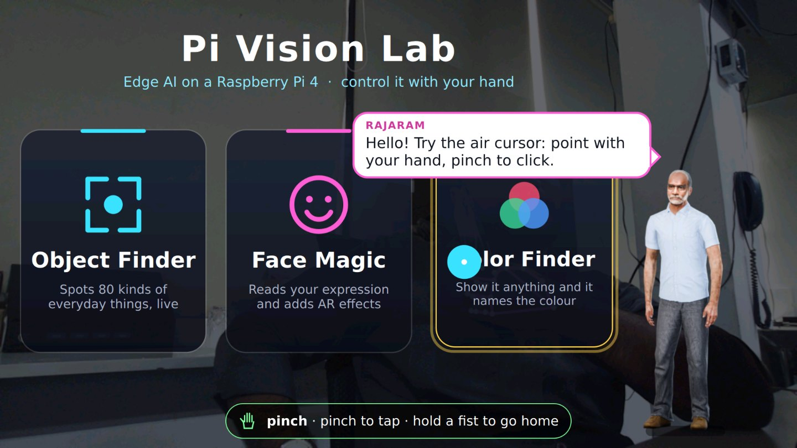
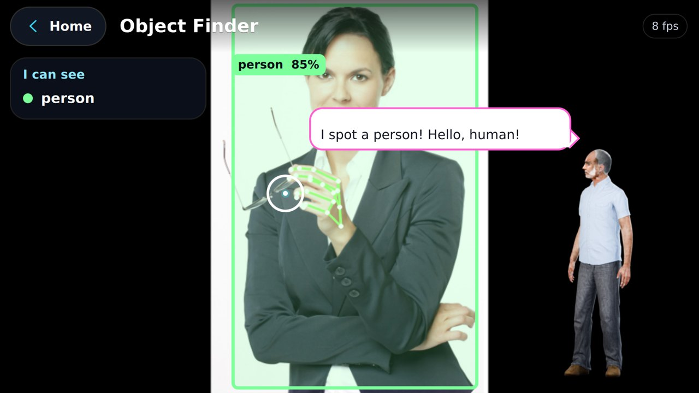
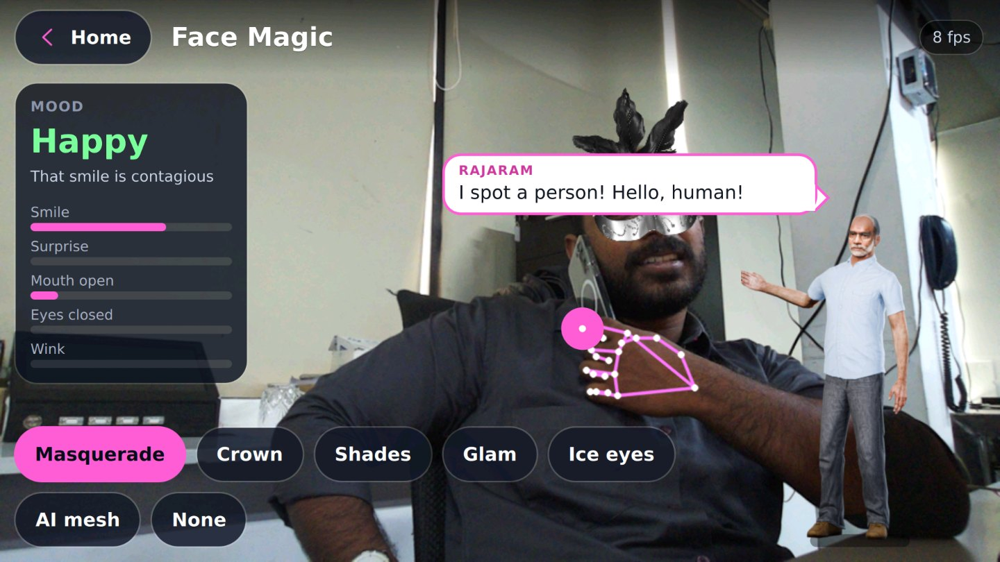
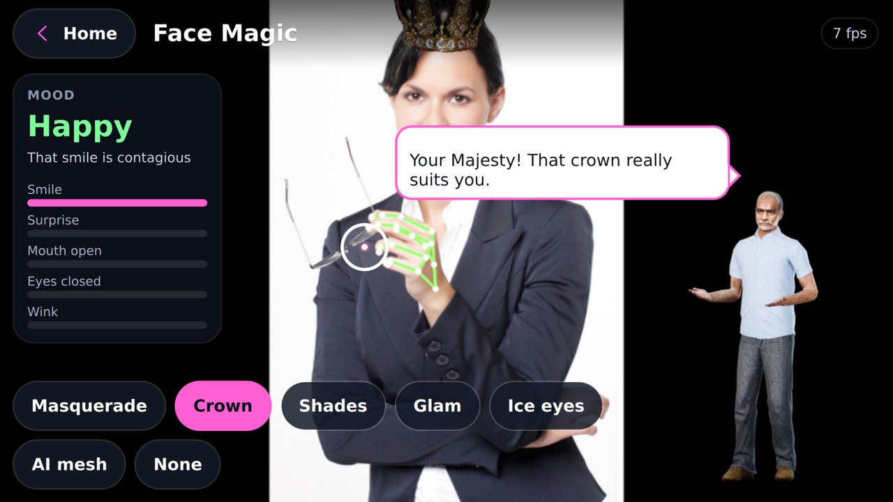
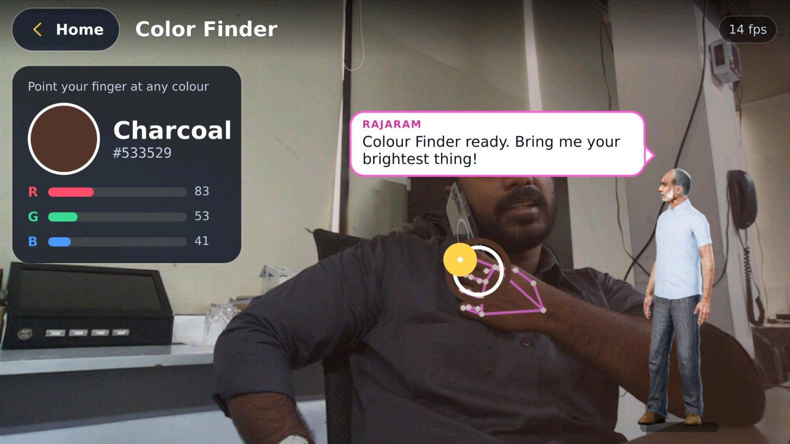
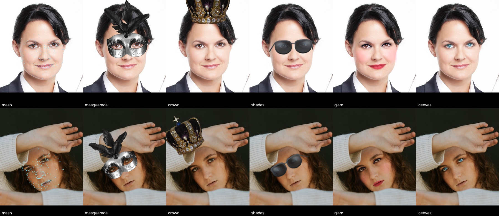

# Pi Vision Lab

**A full-screen, hand-gesture-controlled edge-AI kiosk for the Raspberry Pi 4, hosted by a 3D presenter.**
Everything runs offline on the Pi's CPU. There's no cloud, no API keys and no accelerator. There's also no audio:
visitors point and pinch in the air, and a 3D presenter "talks" in speech bubbles.



| | |
|---|---|
|  |  |
| **Object Finder**: live boxes for 80 everyday object types, with a count | **Face Magic**: a real photo of a masquerade mask, warped to the face |
|  |  |
| **Face Magic**: a jewelled crown, plus a live mood read-out | **Color Finder**: point a finger and it names the colour past your fingertip |

Screenshots are staged with a stock photo as the camera; more are in [docs/screenshots](docs/screenshots). Every Face Magic effect is shown below on stock photos:
masquerade, crown, smoked shades, glam make-up, ice eyes and the AI mesh.



## Features

| Feature | What it does | How |
|---|---|---|
| **Air cursor** | Point to move, **pinch** to click, **hold a fist** for 1 s to go Home | 21-point hand tracking, One Euro filter, debounced pinch, injected as real mouse events |
| **Object Finder** | Live boxes, labels and counts for 80 COCO classes | EfficientDet-Lite0 (TFLite) |
| **Face Magic** | Mood (smile, surprise, wink, sleepy, talking) and 6 photo-real effects | BlazeFace and a 478-point face mesh; effects drawn from the mesh |
| **Color Finder** | Names the colour just past your fingertip | Median patch, nearest of 33 named colours in CIELAB |
| **3D presenter** | A 3D person walks in, presents, waves, comments on what the AI sees, and leaves when it's quiet | Blender-rendered clips of a Microsoft Rocketbox avatar textured from a photo; a rule-based commentary engine |
| **Kiosk** | Boots straight into the app and restarts it if it ever exits | Desktop auto-login, XDG autostart, `run.sh` watchdog |

## Quick start (fresh Raspberry Pi)

You need a **Raspberry Pi 4 (4 GB or more; 8 GB tested)** with **Raspberry Pi OS (Debian 13 "trixie", 64-bit, desktop)**,
a **Camera Module 3** (Wide tested) and a display: the official DSI touch display, or any HDMI monitor.

```bash
git clone https://github.com/hareendranmg/pi-vision-lab.git ~/pi_ai_demo
cd ~/pi_ai_demo
./setup.sh          # apt packages, Python venv, AI models, kiosk autostart (~10 min)
sudo reboot         # the app comes up full-screen ~20 s after boot
```

To try it in a window without rebooting, run `./run.sh --windowed`.
Full instructions, troubleshooting and VNC access are in **[docs/SETUP.md](docs/SETUP.md)**.

## How to use it

1. **Raise a hand** in front of the camera. A cursor follows the point between your thumb and index fingertip.
2. **Pinch** (thumb and index together) to click. The cursor fills as your fingers close, and ripples on the click.
3. **Hold a fist** for one second to go back Home. An orange ring counts down.
4. The touchscreen works too. Every control is a normal Qt control.

## Documentation

| Document | Contents |
|---|---|
| [**How It Works (PDF)**](docs/Pi_Vision_Lab_How_It_Works.pdf) | A 15-page illustrated overview of the technology for technical readers: models, detection and tracking, gestures, effects, the 3D presenter, performance. No code. |
| [docs/ARCHITECTURE.md](docs/ARCHITECTURE.md) | System diagram, threads, the vision pipeline (and why not MediaPipe), gestures, rendering, performance numbers |
| [docs/SETUP.md](docs/SETUP.md) | Hardware, OS, the one-shot installer step by step, displays, VNC, kiosk control, troubleshooting |
| [docs/PRESENTER.md](docs/PRESENTER.md) | How the 3D presenter was built: avatar assembly, face projection, retargeting, rendering, the commentary engine, rebuilding |
| [docs/DEVELOPMENT.md](docs/DEVELOPMENT.md) | Code tour, deploying from a PC, test tools, the remote-control socket, adding effects or lines |

## Technology

- **Raspberry Pi 4**, Raspberry Pi OS trixie, labwc (Wayland), Camera Module 3 via **libcamera / Picamera2**
- **Python 3.13** with **LiteRT** (TensorFlow Lite + XNNPACK), **OpenCV**, **NumPy**
- **Qt 6 / QML** via **PySide6** for the UI, with GPU-scaled camera and presenter textures
- Models: Google **MediaPipe** hand landmarker and face landmarker (run without MediaPipe itself), **EfficientDet-Lite0**
- Presenter: **Blender 5** (Eevee), **Microsoft Rocketbox** avatars and motion capture, photo-to-texture projection

## Repository layout

```
app/              Python application (vision, gestures, presenter, Qt bridge)
qml/              Qt Quick UI: Main.qml, screens/, components/
assets/           Face Magic props, the presenter's rendered clips, credits
presenter_src/    Blender pipeline that builds the presenter (textures + clips)
scripts/          download_models.sh
tools/            test and benchmark helpers, remote-control client
deploy/           autostart entry, headless display profile
docs/             documentation and screenshots
setup.sh          one-shot installer      run.sh   kiosk launcher and watchdog
```

## Licences and credits

- **Code** (everything under `app/`, `qml/`, `tools/`, `scripts/`, `presenter_src/*.py|*.sh`, `setup.sh`, `run.sh`) is under the [MIT licence](LICENSE).
- **The presenter's likeness** is a real person's. The photo, the face texture made from it and the rendered presenter frames in `assets/presenter/` are used **with permission for this project only** and are **not** covered by the MIT licence. Don't reuse them elsewhere.
- **3D avatar and animations:** [Microsoft Rocketbox](https://github.com/microsoft/Microsoft-Rocketbox), MIT ([licence](presenter_src/ROCKETBOX_LICENSE.md)).
- **Face Magic props:** crown photo by Gryffindor, CC BY-SA 3.0; masquerade mask by Alexas_Fotos, CC0. See [assets/CREDITS.md](assets/CREDITS.md).
- **AI models:** Google MediaPipe models and EfficientDet-Lite0, Apache 2.0. They're downloaded at setup, not stored here.
