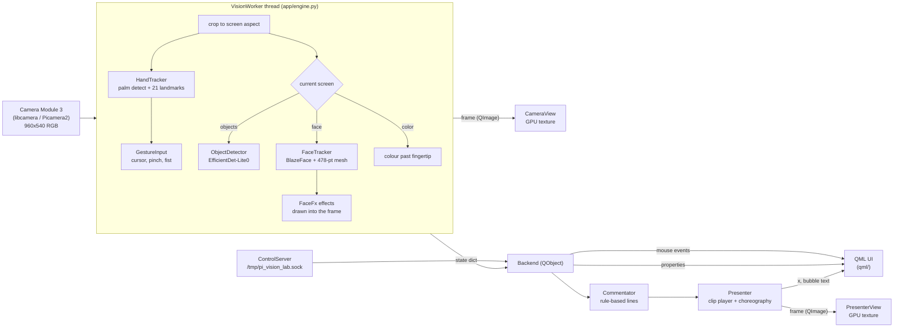
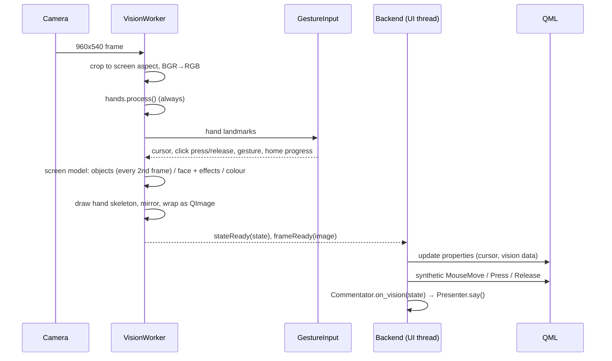
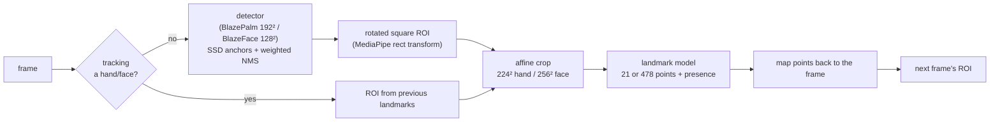
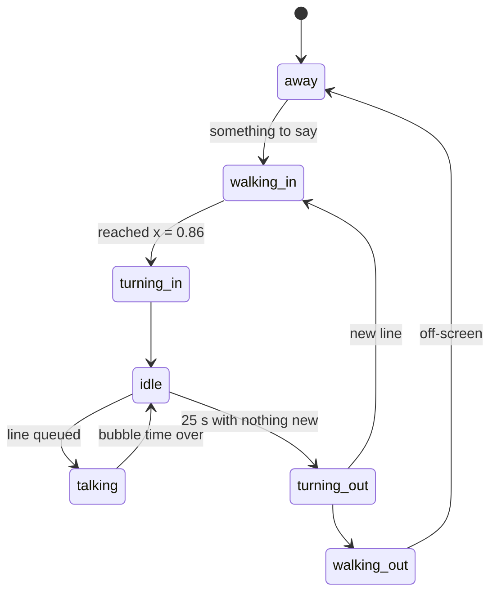

# Architecture

Pi Vision Lab is one Python process. A **vision thread** grabs camera frames and runs the AI models. A **Qt/QML UI**
shows the result full-screen. A **presenter** layer plays a pre-rendered 3D character on top.
All of it runs on the Raspberry Pi 4's four Cortex-A72 cores; the GPU is used only to draw.

## System overview

| Part | File | Role |
|---|---|---|
| Entry point | `app/main.py` | Builds everything, loads `qml/Main.qml` full-screen, starts the threads |
| Vision loop | `app/engine.py` | Camera → crop → models → overlays → mirrored frame + state, ~8–12 times a second |
| Hand / face / object models | `app/vision/` | MediaPipe-equivalent pipelines on LiteRT (see below) |
| Gestures | `app/gesture.py` | Landmarks → cursor position, pinch clicks, pose names, fist-to-home |
| Face effects | `app/face_fx.py` | Masquerade, crown, shades, glam, ice eyes, AI mesh, drawn with OpenCV |
| Colour naming | `app/color.py` | Median patch → nearest of 33 named colours in CIELAB |
| Qt bridge | `app/backend.py` | Exposes state to QML; turns the air cursor into real mouse events; `CameraView` |
| Presenter | `app/presenter.py`, `app/commentary.py` | Plays Rajaram's clips and decides what he says |
| GPU frame item | `app/frameitem.py` | `QQuickItem` + `QSGSimpleTextureNode` so the GPU scales frames |
| Test control | `app/control.py` | Local socket: switch screens, tap, set effects, screenshots, state dump |
| UI | `qml/Main.qml`, `qml/screens/*`, `qml/components/*` | Screens, tiles, air cursor, speech bubble |

## Threads

| Thread | Work | Typical CPU (Pi 4, Object Finder) |
|---|---|---|
| `VisionWorker` | camera read, pre/post-processing, drawing overlays | ~90% of one core |
| LiteRT/XNNPACK workers (3 per model) | neural-network maths | ~40% each |
| Qt main thread | QML bindings, presenter state machine, mouse injection | ~10% |
| Qt render thread | uploads the camera and presenter textures; the GPU scales them | ~20% |
| Presenter preload | decodes all 1,060 presenter PNGs once at start-up (~0.7 GB) | start-up only |

Frames and state cross from the vision thread to the UI through queued Qt signals (`frameReady`, `stateReady`).
Nothing in the UI thread waits on the models.

## Per-frame flow

## Vision pipeline (and why not MediaPipe)

Every MediaPipe Python wheel for Python 3.13 on aarch64 requires the **ARMv8 AES crypto extension**. The Pi 4's
BCM2711 doesn't have it (`/proc/cpuinfo` lists only `fp asimd evtstrm crc32 cpuid`), so MediaPipe crashes at import
with SIGILL. LiteRT, the TensorFlow Lite runtime with XNNPACK, only needs NEON. So `app/vision/` re-implements
MediaPipe's graphs in Python around the **same model files**, unpacked from the `.task` bundles.

- **`common.py`**: SSD anchor generation (MediaPipe `SsdAnchorsCalculator`), box/keypoint decoding, weighted NMS, letterboxing, rotated-ROI crop and inverse mapping.
- **`hands.py`**: palm detection runs only while no hand is tracked (~45 ms). After that, each frame's region comes from the previous landmarks, so tracking costs one ~39 ms landmark pass.
- **`faces.py`**: the short-range BlazeFace sees the frame at 128×128, so a face a couple of metres away would be only ~12 px wide. While searching, it scans **the full frame plus a 3×2 grid of zoomed tiles, one per frame** (~5 ms each). Expressions come from mesh geometry: mouth-corner lift and width, eye aspect ratio, brow height. The smile baseline adapts to each person.
- **`objects.py`**: the EfficientDet-Lite0 Raspberry Pi export has non-max suppression and the COCO label map built in. The label map is read from the zip appended to the `.tflite` file.

Models see the **un-mirrored** frame; everything sent to the UI is **mirrored**, so the screen behaves like a mirror.
The camera frame is first cropped to the window's aspect ratio. Normalised coordinates then map 1:1 onto the screen,
and QML overlays (object boxes, colour reticle) need no extra transform.

## Gestures (`app/gesture.py`)

- **Cursor:** the midpoint of the thumb and index fingertips, which barely moves during a pinch. The central 76×70% of the camera view maps to the whole screen. A One Euro filter keeps it steady when still and responsive when moving.
- **Pinch:** thumb-to-index gap ÷ hand size, with hysteresis (press below 0.26, release above 0.40). Hand size is the largest of several palm measurements, so tilting the hand doesn't fake a pinch. If the thumb rests along the index finger (nearer its middle joint than its tip), it isn't a pinch.
- **Debounce and aim:** a press or release needs **2 consecutive frames**. While pinched, the cursor **freezes where it was ~120 ms before the fingers started closing**, so the click lands on the button you aimed at.
- **Feedback:** `pinchLevel` (0–1) fills the cursor as the fingers approach. `homeProgress` draws the fist countdown ring.
- **Fist to go home:** at least 4 fingertips folded towards the palm centre, held for 1 s. Misread frames shorter than 0.35 s don't reset the timer.
- **Clicks are real input:** `Backend._inject` sends `QMouseEvent` move, press and release events to the `QQuickWindow`. Every QML `MouseArea` and hover effect works with the air cursor exactly as with touch.

## Face Magic effects (`app/face_fx.py`)

Effects are drawn into the camera frame before it's mirrored, using the face mesh scaled to display resolution:

| Effect | Technique |
|---|---|
| Masquerade | Real photo (CC0); its two eye-hole centres are found from the alpha channel and mapped onto the eyes with a similarity transform |
| Crown | Real photo (CC BY-SA); the headband is placed above the forehead, scaled to temple width and rotated with head roll |
| Shades | Wayfarer-shaped lenses sized from the eye span, smoked glass that keeps 16% of the eye visible, soft reflection, gunmetal frame and arms to the temples |
| Glam | Lip, eyelid and cheek polygons from the mesh; colour multiplied by local skin brightness so shading stays real |
| Ice eyes | The iris disc is clipped by the eyelid outline and recoloured by brightness |
| AI mesh | Every third mesh point drawn as a dot |

Landmarks are smoothed with motion-adaptive easing so props don't shimmer but still follow quick head moves.

## Rendering

`CameraView` and `PresenterView` are `QQuickItem`s that hand their latest `QImage` to the scene graph as a texture
(`QSGSimpleTextureNode`), and the GPU scales it to the window. An earlier `QQuickPaintedItem` version scaled the image
on the CPU with QPainter and cost about 30% of a core at 1080p.

## The presenter at runtime (`app/presenter.py`, `app/commentary.py`)

- **Clips:** 10 transparent PNG sequences at 30 fps, 300×540 (`assets/presenter/clips.json`). Idle and talk clips are seamless loops chosen automatically at render time. Cuts between clips are cross-faded over 6 frames.
- **Walking:** the sprite slides at the walk cycle's real stride speed (1.25 m/s), so the feet don't skate.
- **What he says:** `Commentator` turns vision events into lines with per-topic cooldowns, a 5 s minimum gap and no repeats among the last 8 lines. Events: screen opened, effect chosen, mood held for 0.8 s, face lost, a new object seen for over 1 s (with a fun fact), a colour held for 1.2 s, a hand sign held, someone raising a hand after 15 s away.
- **Bubble length:** `1.6 s + 65 ms × characters`, typed out at about 90 characters per second.

How the clips themselves are made is in [PRESENTER.md](PRESENTER.md).

## Performance (Pi 4, 8 GB, 1080p HDMI, presenter on screen)

| Screen | Models per frame | fps |
|---|---|---|
| Home | hands | ~11.6 |
| Object Finder | hands + objects on alternate frames | ~8.5 |
| Face Magic | hands + face mesh + effects | ~9.4 |
| Color Finder | hands | ~9.3 |

| Model (3 threads) | Time |
|---|---|
| Palm detection (searching only) | ~45 ms |
| Hand landmarks | ~39 ms |
| Face detection (searching only, per tile) | ~5 ms |
| Face mesh | ~32 ms |
| EfficientDet-Lite0 | ~70 ms |

Optimisations that got here:
- GPU-scaled textures instead of QPainter.
- Presenter frames preloaded off the UI thread.
- Object detection on alternate frames.
- 3 inference threads per model instead of 4, which stopped two models from oversubscribing 4 cores.
- Palm and face detectors run only while searching.

On the 800×480 DSI display it's faster still, because there are fewer pixels to draw.

## Design decisions

| Decision | Why |
|---|---|
| PySide6/QML (pip wheel) instead of a browser kiosk | Native, GPU-composited, no Chromium overhead competing with the models; `sudo apt` isn't needed for Qt |
| Venv with `--system-site-packages` | Keeps Raspberry Pi OS's apt-built `picamera2`/`libcamera`/`numpy` (built against the system libcamera) |
| Rule-based commentary, no LLM | Works offline, instantly, with no API keys; no microphone or speaker by design |
| Pre-rendered 3D presenter instead of real-time 3D | The Pi 4 GPU can't render a photoreal skinned human live; sprites cost almost nothing at runtime |
| Air cursor as synthetic mouse events | One input path for touch and gestures; no gesture-specific code in QML |
| Local control socket | Remote testing and screenshots without a keyboard, VNC password or touch |
