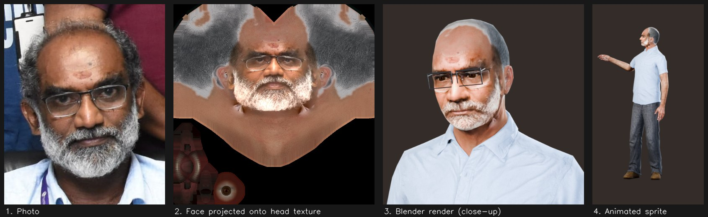

# Rajaram, the 3D presenter



Rajaram is a **pre-rendered 3D character**. A photoreal skinned human is far beyond what the Pi 4 GPU can render live.
So every movement is rendered once in Blender on a PC into transparent PNG frames, and the Pi just plays them
(see [ARCHITECTURE.md](ARCHITECTURE.md#the-presenter-at-runtime-apppresenterpy-appcommentarypy)).
The rendered clips are committed in `assets/presenter/`, so a new Pi doesn't need Blender.

> His likeness (photo, face texture, rendered frames) is used with his permission for this project only. It isn't
> covered by the repository's MIT licence.

## Ingredients

| Ingredient | Source | Licence |
|---|---|---|
| Body with a half-sleeve shirt and trousers | Rocketbox `Male_Adult_11` | MIT |
| Bald older head | Rocketbox `Male_Adult_14` | MIT |
| Skeleton and motion capture (idle, talk ×2, excited, present, wave, walk, turn) | Rocketbox `m_*` animations | MIT |
| His face, beard and skin tone | `presenter_src/rajaram/rajaram_front.jpg` | with permission |
| Rectangular glasses | modelled by the script | MIT |

`presenter_src/fetch_rocketbox.sh` downloads the Rocketbox files (~300 MB, not stored in this repo).

## Step 1: textures (`presenter_src/make_textures.py`)

Run with ordinary Python 3 (OpenCV, Pillow, SciPy) on a PC.

1. **Body recolour.** The base shirt is olive (hue ≈ 33), distinct from the blue jeans, brown shoes and skin, so colour alone finds every shirt island in the texture, including narrow side panels. Each region is repainted with a flat colour plus the original high-pass luminance, so folds, buttons and the pocket survive:
   - shirt → pale blue `#ACC6E8`
   - jeans → charcoal trousers `#3A3C42`
   - arm skin → his skin tone, by Reinhard Lab colour transfer from his cheeks in the photo
2. **Head skin and hair.** The head texture's skin is shifted to his tone. The brown hair ring is detected (darker than skin, away from the face) and turned grey-white with its strand texture kept.
3. **Face projection.** `tools/face_landmarks.py` finds the same **478 face-mesh points** on his photo and on the *unwrapped head texture* (the mesh detects the flattened face in UV space). The two point sets are Delaunay-triangulated, with an extra band below the jaw so his beard continues onto the neck. Each triangle is affine-warped from the photo into texture space, and the result is `seamlessClone`d (Poisson blending) in so its edges match the surrounding skin.
4. **Finishing.** The skin is darkened a little (renders come out lighter than a flash photo), the Rocketbox grey-green irises are recoloured dark brown, and island edges are padded (colour bleed) so texture filtering at UV seams never shows dark lines.

Outputs: `presenter_src/rajaram/Textures/{head,body}_color.png`.

## Step 2: clips (`presenter_src/render_presenter.py`)

Run headless with Blender 5.x:

```bash
cd presenter_src
./fetch_rocketbox.sh
python3 make_textures.py                      # only if the photo or colours changed
blender -b -P render_presenter.py             # all clips (~40 min on an RTX 3060)
blender -b -P render_presenter.py -- --only present,wave     # some clips
blender -b -P render_presenter.py -- --test   # one still per clip, to check poses
blender -b -P render_presenter.py -- --closeup --only idle   # face close-up
```

What the script does:

- **Hybrid avatar.** It imports both Rocketbox men, deletes the head faces from one and the body faces from the other, and binds the bald head to the body's skeleton (same `Bip01` bone names). It applies the new textures and models the glasses from the eye-bone positions, parented to `Bip01 Head`.
- **Retargeting.** Rocketbox animations are keyed on a **T-pose** rig while the avatars rest in an **A-pose** (45° apart at the upper arm). Copying local rotations would leave the arms sticking out. Instead, each clip's own skeleton is imported hidden as a *driver*, and every avatar bone gets a **world-space Copy Rotation** constraint (the pelvis also copies location).
- **In-place walking.** Walk and turn clips carry root motion, sometimes on the object rather than the pelvis. Each frame, the driver is counter-moved to pin the pelvis over the origin, using that frame's own object position. The app slides the sprite instead, at the cycle's 1.25 m/s stride speed.
- **Facing.** Clips are rotated with a parent "pivot" empty, because the clips key their own root rotation:
  - walk-in faces screen-left (−90°)
  - turn-in ends facing the audience
  - standing clips are angled −15° towards the screen content on the left, and the presenting gesture uses his right hand
  - turn-out and walk-out leave to the right
- **Seamless loops.** For idle and talk clips, the script compares world rotations of 10 key bones across every frame pair and picks the 4–8 s window whose last pose best matches its first.
- **Render.** Eevee, transparent film, AgX, a three-point area-light rig, an 85 mm camera at 8.4 m (the sprite covers 2.37 m of height), 300×540 at 30 fps. Output goes to `assets/presenter/<clip>/NNNN.png` and `clips.json` (frame counts).

## Swapping the person

1. Replace `presenter_src/rajaram/rajaram_front.jpg` with a sharp, front-on, evenly lit photo. Remove glasses if you can, because their reflections bake into the skin.
2. Recompute landmarks. You need the models from `scripts/download_models.sh` and `ai-edge-litert`; running on the Pi is easiest:
   ```bash
   python3 tools/face_landmarks.py presenter_src/rajaram/rajaram_front.jpg presenter_src/rajaram/photo_landmarks.npy
   python3 tools/face_landmarks.py presenter_src/Male_Adult_14/Textures/m012_head_color.tga presenter_src/rajaram/head_landmarks.npy
   ```
3. Adjust `SHIRT_RGB` / `TROUSER_RGB` in `make_textures.py` if you like, remove `add_glasses()` for someone without glasses, then run `make_textures.py` and `render_presenter.py`.
4. Change the name in `qml/components/Presenter.qml` (bubble header) and `app/commentary.py` (his introduction).

## The commentary engine (`app/commentary.py`)

Rule-based and offline. `Commentator` receives the vision state every frame plus screen and effect changes, and
returns `(text, gesture)` when something new deserves a comment. The gesture picks the clip: `talk`, `present`,
`excited` or `wave`.

| Event | Example line |
|---|---|
| Screen opened | "Face Magic! I track 478 points on your face, live." |
| Effect chosen | "Your Majesty! That crown really suits you." |
| Mood held | "Love that smile!" or "Did you just wink at me?" |
| Object seen > 1 s | "I spot a cup! Coffee or tea? I run on electricity myself." / "I count 3 people. Welcome, everyone!" |
| Colour held | "That's Turquoise, like tropical water!" |
| Hand sign | "Thumbs up right back at you!" |
| Someone arrives | "Oh hi there! Pinch to click, make a fist to go home." |

Rate limiting: a 5 s minimum gap between lines, per-topic cooldowns (20–45 s), and no repeats among the last 8 lines.
To add lines, extend the dictionaries at the top of the file.
